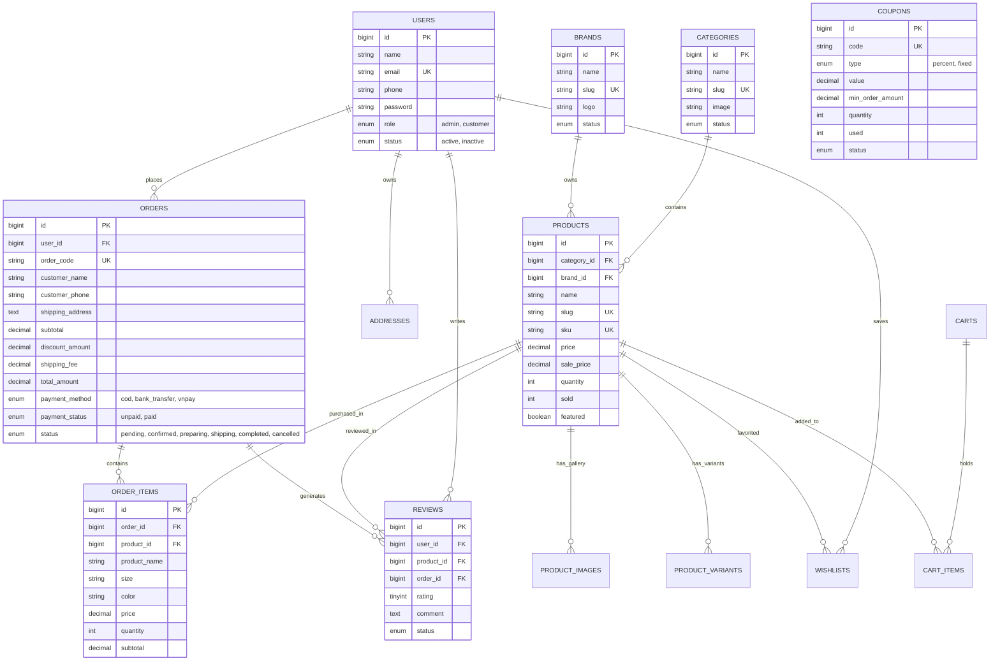

# 🏆 HỆ THỐNG THƯƠNG MẠI ĐIỆN TỬ CỬA HÀNG DỤNG CỤ THỂ THAO (SPORT STORE)

> **Đề tài:** Phát triển hệ thống thương mại điện tử cho cửa hàng dụng cụ thể thao theo kiến trúc chuẩn MVC trên nền tảng **Laravel 12 (PHP 8.2+)**, **MySQL**, **Bootstrap 5**, **Chart.js** và **SweetAlert2**.

---

## 📌 1. GIỚI THIỆU HỆ THỐNG
Website thương mại điện tử **Sport Store** cung cấp giải pháp toàn diện cho việc phân phối trực tuyến các thiết bị, dụng cụ và trang phục thể thao chính hãng:
- **Khách hàng (Client):** Trải nghiệm giao diện năng động, hiện đại; tra cứu sản phẩm theo bộ môn (Bóng đá, Cầu lông, Tennis, Bóng rổ, Gym...); bộ lọc nâng cao (thương hiệu, khoảng giá, size, màu, rating); giỏ hàng tiện ích, mã coupon giảm giá linh hoạt, thanh toán đa phương thức và theo dõi tiến trình đơn hàng trực quan qua timeline.
- **Quản trị viên (Admin):** Bảng điều khiển phân tích thông minh với biểu đồ doanh thu Chart.js, quản lý kho hàng tự động cảnh báo tồn kho thấp (≤ 5), quy trình duyệt đơn hàng nghiêm ngặt chống lỗi logic, kiểm duyệt đánh giá và quản lý mã khuyến mãi.

---

## 💻 2. CÔNG NGHỆ SỬ DỤNG
- **Backend:** PHP 8.2+, Laravel 12 (MVC, Eloquent ORM, Service Layer, Form Requests, Middleware, Database Transactions).
- **Database:** MySQL (chuẩn hóa 3NF, Foreign Keys, Indexes, Cascading/Set Null constraints).
- **Frontend:** Blade Template Engine, HTML5, CSS3, Bootstrap 5.3, Font Awesome 6.
- **Thư viện tương tác:** SweetAlert2 (thông báo & popup xác nhận), Chart.js (biểu đồ doanh thu & trạng thái đơn hàng).
- **Bảo mật:** CSRF Token, Mass Assignment Protection, Password Hashing (`bcrypt`), Role-Based Access Control (RBAC), XSS/SQL Injection Prevention.

---

## 🏛️ 3. SƠ ĐỒ THỰC THỂ LIÊN KẾT (ERD MERMAID)



---

## ⚙️ 4. HƯỚNG DẪN CÀI ĐẶT & CHẠY ỨNG DỤNG

### Bước 1: Mở terminal tại thư mục dự án
```bash
cd pthttmdt
```

### Bước 2: Cài đặt dependencies (PHP & Node.js)
```bash
composer install
npm install
npm run build
```

### Bước 3: Cấu hình tệp môi trường `.env`
Kiểm tra cấu hình kết nối database trong tệp `.env`:
```env
APP_NAME="Sport Store"
APP_ENV=local
APP_KEY=base64:d3h6VfsQ1RKQchjQc3pHt2GJahtBQDCCb2a4DZv9L/g=
APP_DEBUG=true
APP_URL=http://127.0.0.1:8000

DB_CONNECTION=mysql
DB_HOST=127.0.0.1
DB_PORT=3310
DB_DATABASE=sports_store
DB_USERNAME=root
DB_PASSWORD=12345
```
*(Nếu máy tính của bạn sử dụng port mặc định 3306 hoặc mật khẩu rỗng, hãy thay đổi tương ứng `DB_PORT=3306` và `DB_PASSWORD=`).*

### Bước 4: Tạo cơ sở dữ liệu và dữ liệu mẫu (Seed)
```bash
php artisan migrate:fresh --seed
php artisan storage:link
```

### Bước 5: Khởi chạy máy chủ ảo
```bash
php artisan serve
```
Mở trình duyệt truy cập:
- **Trang bán hàng (Frontend):** [http://127.0.0.1:8000](http://127.0.0.1:8000)
- **Trang quản trị (Admin Portal):** [http://127.0.0.1:8000/admin](http://127.0.0.1:8000/admin)

---

## 🔑 5. TÀI KHOẢN MẪU ĐĂNG NHẬP

| Vai trò | Email đăng nhập | Mật khẩu | Quyền hạn |
| :--- | :--- | :--- | :--- |
| **Quản trị viên (Admin)** | `admin@sportstore.com` | `12345678` | Toàn quyền quản trị Dashboard, Sản phẩm, Đơn hàng, Kho, Khách hàng, Doanh thu |
| **Khách hàng mẫu 1** | `an.nguyen@gmail.com` | `12345678` | Đặt hàng, theo dõi đơn, gửi đánh giá, đổi mật khẩu, sổ địa chỉ |
| **Khách hàng mẫu 2** | `binh.tran@gmail.com` | `12345678` | Khách hàng thân thiết có lịch sử mua hàng sẵn |

---

## 🎟️ 6. MÃ GIẢM GIÁ MẪU CÓ SẴN (COUPONS)

- **`SPORT10`**: Giảm 10% (Tối đa 100.000đ cho đơn từ 300.000đ).
- **`TET2026`**: Giảm 15% (Tối đa 200.000đ cho đơn từ 500.000đ).
- **`GIAM50K`**: Giảm trực tiếp 50.000đ cho đơn từ 250.000đ.
- **`FREESHIP`**: Miễn phí 30.000đ phí giao hàng cho đơn từ 200.000đ.
- **`VIPPRO`**: Giảm 20% (Tối đa 500.000đ cho đơn từ 1.000.000đ).

---

## 📁 7. CẤU TRÚC THƯ MỤC CHUẨN DỰ ÁN

```
pthttmdt/
├── app/
│   ├── Http/
│   │   ├── Controllers/
│   │   │   ├── AuthController.php
│   │   │   ├── HomeController.php
│   │   │   ├── ProductController.php
│   │   │   ├── CartController.php
│   │   │   ├── CheckoutController.php
│   │   │   ├── OrderController.php
│   │   │   ├── AccountController.php
│   │   │   ├── AddressController.php
│   │   │   ├── WishlistController.php
│   │   │   ├── ReviewController.php
│   │   │   ├── CouponController.php
│   │   │   ├── AdminDashboardController.php
│   │   │   ├── AdminCategoryController.php
│   │   │   ├── AdminBrandController.php
│   │   │   ├── AdminProductController.php
│   │   │   ├── AdminOrderController.php
│   │   │   ├── AdminCustomerController.php
│   │   │   ├── AdminCouponController.php
│   │   │   ├── AdminReviewController.php
│   │   │   ├── AdminBannerController.php
│   │   │   ├── AdminInventoryController.php
│   │   │   └── AdminReportController.php
│   │   ├── Middleware/
│   │   │   └── AdminMiddleware.php
│   │   └── Requests/
│   │       ├── RegisterRequest.php
│   │       ├── LoginRequest.php
│   │       ├── CheckoutRequest.php
│   │       ├── StoreProductRequest.php
│   │       ├── UpdateProductRequest.php
│   │       ├── StoreCategoryRequest.php
│   │       ├── UpdateCategoryRequest.php
│   │       ├── StoreBrandRequest.php
│   │       ├── UpdateBrandRequest.php
│   │       ├── CouponRequest.php
│   │       └── ReviewRequest.php
│   ├── Models/
│   │   ├── User.php
│   │   ├── Category.php
│   │   ├── Brand.php
│   │   ├── Product.php
│   │   ├── ProductImage.php
│   │   ├── ProductVariant.php
│   │   ├── Order.php
│   │   ├── OrderItem.php
│   │   ├── Coupon.php
│   │   ├── Review.php
│   │   ├── Wishlist.php
│   │   ├── Address.php
│   │   ├── Banner.php
│   │   ├── Cart.php
│   │   └── CartItem.php
│   └── Services/
│       ├── CartService.php
│       ├── OrderService.php
│       ├── CouponService.php
│       ├── ProductService.php
│       ├── PaymentService.php
│       ├── ImageService.php
│       └── ReportService.php
├── database/
│   ├── migrations/ (16 files migration đầy đủ)
│   └── seeders/ (User, Category, Brand, Product, Coupon, Banner, Order)
├── resources/
│   └── views/
│       ├── layouts/ (app.blade.php, admin.blade.php)
│       ├── auth/ (login.blade.php, register.blade.php)
│       ├── frontend/
│       │   ├── home.blade.php
│       │   ├── components/product-card.blade.php
│       │   ├── products/ (index.blade.php, show.blade.php)
│       │   ├── cart/index.blade.php
│       │   ├── checkout/ (index.blade.php, success.blade.php)
│       │   └── account/ (layout, index, profile, orders, addresses, wishlist, password)
│       ├── admin/ (dashboard, categories, brands, products, orders, customers, coupons, reviews, banners, inventory, reports)
│       └── errors/ (403.blade.php, 404.blade.php, 500.blade.php)
└── routes/
    └── web.php (87 routes hoàn chỉnh)
```

---

## 🧪 8. DANH MỤC KIỂM THỬ HỆ THỐNG (TEST CHECKLIST)

- [x] **Authentication:** Đăng ký tài khoản mới (validate email, phone, mật khẩu confirmed), đăng nhập, ghi nhớ mật khẩu, đăng xuất an toàn.
- [x] **Phân quyền Role:** Chặn tài khoản customer hoặc khách vãng lai truy cập `/admin` (trả về lỗi 403 / redirect). Admin truy cập `/admin/dashboard` thành công.
- [x] **Danh mục & Thương hiệu:** Xem danh sách, tìm kiếm, lọc theo bộ môn, CRUD quản trị viên.
- [x] **Sản phẩm & Biến thể:** Hiển thị sản phẩm dạng lưới, sắp xếp giá/bán chạy/mới nhất, phân trang. Chi tiết sản phẩm với bộ sưu tập ảnh, chọn size/màu, tính năng hết hàng tự động khóa nút mua.
- [x] **Giỏ hàng:** Thêm sản phẩm, tăng/giảm số lượng, kiểm tra không vượt quá tồn kho còn lại, xóa sản phẩm, xóa toàn bộ giỏ.
- [x] **Mã giảm giá:** Áp dụng mã `SPORT10` giảm 10%, kiểm tra điều kiện đơn hàng tối thiểu và ngày hiệu lực.
- [x] **Đặt hàng (Checkout):** Bắt buộc đăng nhập, chọn địa chỉ có sẵn, phương thức COD/Chuyển khoản/VNPay, xử lý Database Transaction trừ tồn kho và tăng số lượt bán.
- [x] **Quản lý đơn hàng:** Khách hàng theo dõi timeline tiến trình đơn, hủy đơn hàng khi trạng thái là `pending` (tự động hoàn lại số lượng tồn kho).
- [x] **Đánh giá sản phẩm:** Chỉ khách hàng đã mua sản phẩm và đơn hàng ở trạng thái `completed` mới được quyền gửi đánh giá từ 1-5 sao.
- [x] **Quản trị Dashboard:** Biểu đồ doanh thu 7 ngày, 12 tháng, cơ cấu trạng thái đơn hàng (Chart.js), danh sách sản phẩm cảnh báo sắp hết hàng (≤ 5).
